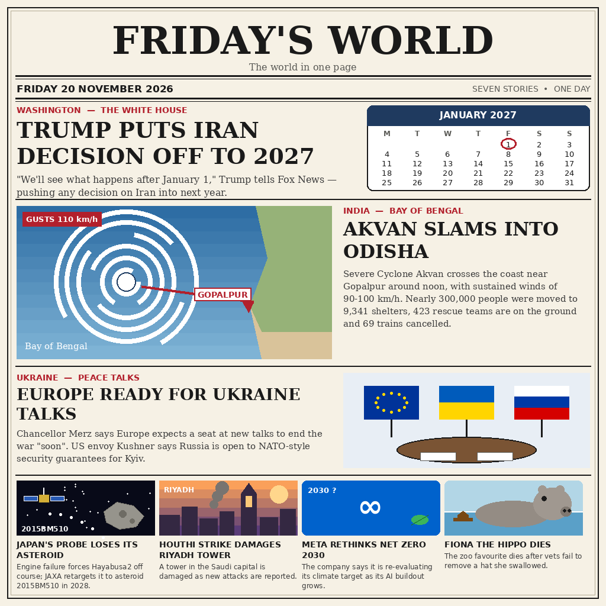

# FRIDAY'S WORLD — 20 November 2026

[](https://make.fun/bounty/news-image-20261120)
[](https://make.fun/bounty/news-image-20261120)
[](https://make.fun/bounty/news-image-20261120)

A newspaper front page summing up Friday 20 November 2026's world news — drawn entirely in code. No photographs, no external images: every picture on the page (the January 2027 calendar, the cyclone spiral over the Bay of Bengal, the three flags over the negotiating table, the asteroid probe, the Riyadh skyline, the Meta infinity loop, Fiona the hippo) is shapes and text rendered by Pillow.



## How it works

- `make_image.py` draws `entry.png` (1024 × 1024) deterministically with Pillow: masthead, dateline, a lead story on the Iran decision, and six picture stories, each with its own hand-coded illustration (calendar grid, spiral cyclone, flags, deep space, dusk skyline, pool).
- `main.py` is the competition entry point. It uses only the Python standard library and copies the repo's `entry.png` to `/output/entry.png` (creating `/output` if needed).
- Re-running `make_image.py` produces byte-identical output.

```bash
python3 make_image.py   # regenerate entry.png
python3 main.py         # copy entry.png to /output/entry.png
```

## Stories covered

| Story | Headline on the page |
|---|---|
| Trump puts the Iran decision off to 2027: "We'll see what happens after January 1" | TRUMP PUTS IRAN DECISION OFF TO 2027 |
| Severe Cyclone Akvan crosses the Odisha coast near Gopalpur; ~300,000 evacuated | AKVAN SLAMS INTO ODISHA |
| Europe expects a seat at new Ukraine peace talks; Kushner says Russia is open to NATO-style guarantees | EUROPE READY FOR UKRAINE TALKS |
| Engine failure forces Japan's Hayabusa2 off its asteroid course; retargeted to 2015BM510 | JAPAN'S PROBE LOSES ITS ASTEROID |
| Houthi strike damages a tower in Riyadh | HOUTHI STRIKE DAMAGES RIYADH TOWER |
| Meta re-evaluates its 2030 net-zero target as its AI buildout grows | META RETHINKS NET ZERO 2030 |
| Fiona the hippo dies after vets fail to remove a swallowed hat | FIONA THE HIPPO DIES |

## License

MIT — see [LICENSE](LICENSE).
